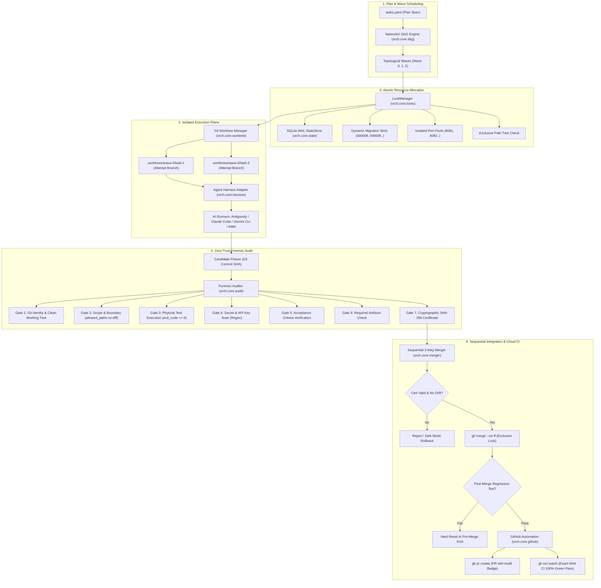

# AgentNexus (CLI: `nexus`)

`AgentNexus` is an executable Python 3.12+ control plane for coordinating multiple autonomous coding agents against one Git repository without treating agent prose as proof of completion.

Its safety model is based on four rules:

1. **No hallucinated state** — mutable runtime truth lives in SQLite, while physical Git/process state is re-read when it matters.
2. **Physical evidence is mandatory** — Git SHAs, real files, command argv, exit codes, logs, hashes, and audit artifacts are the evidence layer.
3. **No false completion** — workers only produce candidates. Independent audit and post-merge regression decide whether a task may advance.
4. **Strict scope enforcement** — write ownership, ports, migration slots, branches, attempts, and integration are explicitly isolated.

## What is included

- NetworkX DAG validation and deterministic execution waves.
- SQLite WAL state store with optimistic version checks and append-only events.
- Atomic path, migration-slot, and port allocation with generation fencing.
- Attempt-scoped native Git worktrees created from exact base SHAs.
- Attempt-scoped temporary/home/cache/state/artifact directories.
- Generic CLI, Claude Code, Gemini CLI, Antigravity and Aider adapters with runtime capability discovery.
- Async subprocess supervision with bounded timeouts, durable redacted stdout/stderr/events, and process identity evidence.
- A seven-gate zero-trust audit: Git identity, scope, independent verification, secrets, acceptance criteria, artifacts, sign-off.
- Deterministic SHA-256 audit certificates bound to the candidate and evidence manifest.
- Sequential no-ff integration, exact pre-merge SHA rollback, merge journaling, and crash reconciliation from Git parents.
- Optional `gh` integration for PRs and exact-SHA CI status.
- Recovery scanning, recovery bundles, stale-process handling, and fail-closed SAFE_MODE planning.
- Typer/Rich CLI (`nexus`, with `agentnexus` and `orch` aliases) plus the same Python core services for programmatic use.

## System Architecture



## Codebase Architecture Map

The package is strictly organized by responsibility:

```text
orch/
├── cli/                      # Typer + Rich Terminal Interface
│   ├── main.py               # Root CLI app ('nexus', 'agentnexus', 'orch')
│   ├── doctor_cmd.py         # Runtime dependency & environment verifier
│   ├── init_cmd.py           # Metadata (.orch/) & SQLite DB initialization
│   ├── plan_cmd.py           # Plan validation, DAG status, wave inspection
│   ├── spawn_cmd.py          # Worktree allocation, agent process spawning
│   ├── lock_cmd.py           # Active path, port & migration lock viewer
│   ├── audit_cmd.py          # 7-step zero-trust forensic audit runner
│   ├── merge_cmd.py          # Sequential 3-way merger & rollback engine
│   ├── pr_cmd.py             # GitHub PR automation & CI watcher bridge
│   └── recover_cmd.py        # Orphaned process & broken worktree garbage collector
├── core/                     # Core Business Logic & State Machines
│   ├── dag.py                # NetworkX DAG resolver, cycle detector & wave partitioner
│   ├── state.py              # SQLite WAL state persistence with optimistic versioning
│   ├── locks.py              # ACID lock manager (Path tree, Port, Migration slot)
│   ├── worktree.py           # Git worktree lifecycle (create, verify, prune)
│   ├── environment.py        # Runtime sandbox environment & secret scrubbers
│   ├── process.py            # Async subprocess supervisor with bounded timeouts
│   ├── audit.py              # 7-gate forensic auditor & SHA-256 certificate signer
│   ├── merger.py             # Sequential --no-ff merger with auto-rollback on regression
│   ├── github.py             # GitHub CLI ('gh') bridge for PRs & exact-SHA CI watch
│   ├── recovery.py           # Safe-mode recovery, crash parent reconciliation
│   └── harness/              # AI Sub-agent CLI Adapters
│       ├── base.py           # Abstract Base Adapter & execution contract
│       ├── antigravity.py    # Google DeepMind Antigravity CLI adapter ('agy')
│       ├── claude_code.py    # Anthropic Claude Code adapter ('claude')
│       ├── gemini_cli.py     # Google Gemini CLI adapter ('gemini')
│       ├── aider.py          # Aider CLI adapter ('aider')
│       └── generic_cli.py    # Universal subprocess adapter for custom agents
└── models/                   # Strict Pydantic v2 Models (extra='forbid')
    ├── task.py               # TaskSpec, Wave, Ownership, Resource models
    ├── lock.py               # LockTable, ResourceRequest, MigrationSlot models
    ├── audit.py              # AuditReport, AuditFinding, CertificateDigest
    ├── merge.py              # MergeResult, MergeQueue, CIState models
    └── state.py              # FSM TaskState, RunState, TransitionActor enums
```

## Install

```bash
python -m pip install -e .
nexus --help
```

The build backend is Hatchling. Runtime dependencies are Typer, Rich, Pydantic v2, NetworkX and PyYAML. SQLite and subprocess/asyncio are from the Python standard library.

## Quick start

Initialize metadata in an existing Git repository:

```bash
nexus init
```

Validate a plan without changing runtime state:

```bash
nexus plan validate tasks.example.yaml
```

Activate it:

```bash
nexus plan validate tasks.example.yaml --activate
nexus plan status
```

Spawn one task or one topological wave:

```bash
nexus spawn --task TASK-001
nexus spawn --wave 0
```

Audit and integrate candidates:

```bash
nexus audit run TASK-001
nexus merge sequential --dry-run
nexus merge sequential
```

Optional GitHub lifecycle:

```bash
nexus pr create-all
nexus pr watch-ci --pr 123 --sha <exact-head-sha>
```

Recovery and diagnostics:

```bash
nexus recover --dangling --dry-run
nexus recover --dangling
nexus doctor
nexus logs TASK-001 --tail 200
```

## Task plan model

A task declares dependencies, role, write ownership, resources, acceptance criteria, verification commands, artifacts, harness and retry/time limits. Unknown Pydantic fields are rejected rather than ignored.

```yaml
version: 1
project:
  name: example

tasks:
  - id: TASK-001
    title: Add lock engine
    description: Implement transactional path/resource locking.
    role: core_backend
    dependencies: []
    ownership:
      allowed_paths:
        - orch/core/locks.py
        - tests/component/test_locks.py
      readonly_paths:
        - pyproject.toml
      forbidden_paths:
        - .github/**
        - .env
    resources:
      migration_count: 1
      ports:
        api: 1
    acceptance:
      criteria: []
    verification:
      - type: command
        command: [pytest, tests/component/test_locks.py, -q]
    timeout_seconds: 1800
    max_attempts: 2
    priority: 10
    allow_noop: false
```

## State model

The task FSM is:

```text
PENDING -> READY -> ASSIGNED -> SPAWNED -> IN_PROGRESS
       -> AUDIT_READY -> AUDITED -> MERGING -> COMPLETED
```

Failure paths use `REJECTED` and `RECOVERING`. State changes are authority-checked: a worker cannot mark its own task `AUDITED`, `MERGING`, or `COMPLETED`.

Each retry has its own `attempt_id`, generation, branch and worktree. Stale generations cannot renew leases or mutate current task state.

## Resource safety

Assignment is a single `BEGIN IMMEDIATE` transaction. Path leases, migration slots, ports and the `READY -> ASSIGNED` state change either commit together or roll back together.

Path rules are normalized repository-relative paths. Traversal and symlink escapes are rejected. Simple tree-prefix overlaps are proven explicitly; ambiguous exclusive glob combinations fail closed.

Migration numbers are monotonic and are not reused for another attempt. Ports are leased from configured pools. A supervisor heartbeat renews active leases while the worker runs.

## Worktree and harness isolation

Every attempt gets an isolated branch and worktree under `.worktrees/<run>/<task>/<attempt>`. The worktree is created from the exact persisted base SHA and verified after creation.

The runtime also creates `.orch/runtime/<attempt>/` with isolated temp, home, cache, state and artifact directories. Environment passthrough is allowlist-based; known deployment/token variables are not copied by default.

Vendor adapters are execution providers, not authorities. Availability is discovered at runtime. If a CLI or required headless mode cannot be demonstrated, the adapter fails closed.

## Audit model

Audit is independent and read-only with respect to the candidate. Its seven gates are:

1. Git identity and clean workspace.
2. Diff/scope boundary.
3. Independent command verification.
4. Secret and credential scan.
5. Acceptance criteria.
6. Required artifacts/contracts.
7. Final sign-off.

`UNKNOWN`, `FAIL`, and `VIOLATION` never become `PASS` by scoring. A required manual review remains unknown until somebody actually supplies that evidence.

The certificate binds the run/task/attempt, base and head SHAs, full task-spec hash, prompt hash, gate dispositions, and the audit evidence manifest. Merge re-hashes evidence files; changing evidence or the candidate after audit makes the certificate stale.

## Integration and rollback

`nexus merge sequential` processes audited candidates one at a time. The default config uses a dedicated `orch/integration/<run>` worktree/branch; `direct_main` is available for repositories that explicitly want it.

Before Git mutation the controller checks the exact candidate SHA, certificate and integration SHA. Clean integration uses `git merge --no-ff`. A conflict is aborted. A post-merge regression failure resets to the exact persisted pre-merge SHA.

Merge attempts are journaled. If the orchestrator dies after the physical merge but before durable finalization, recovery can prove the merge from the merge commit's two parent SHAs; otherwise it fails closed rather than guessing.

## GitHub integration

GitHub support is optional and uses the `gh` CLI. The engine checks capability/authentication at runtime. Candidate pushes do not use `--force`; a divergent remote branch is an error.

CI evidence must correspond to the exact expected head SHA and configured required checks. "Latest repository run" is not sufficient evidence for a different commit.

## Recovery

`nexus recover --dangling` reconciles persisted intent against observed processes/Git state. Unknown or contradictory physical state can put the run into `SAFE_MODE`, which blocks new unsafe mutations while inspection and recovery remain available.

Recovery never treats an unknown PID/worktree as owned merely because it looks stale. Dirty work should be snapshotted before destructive cleanup.

## Configuration

Configuration lives in `.orch/config.yaml`. Environment overrides use `ORCH_<SECTION>__<FIELD>`, for example:

```bash
ORCH_SCHEDULER__MAX_PARALLEL_AGENTS=10 nexus plan status
```

Default values include eight parallel agents, 60-second heartbeat timeout, 120-second resource leases, and separate API/web/test port pools.

## Security boundaries and limitations

A native local coding CLI is **not** a syscall sandbox. `AgentNexus` provides Git worktree isolation, environment separation, resource ownership, exact evidence, and independent audit, but a native process may still access anything the operating-system user can access. Use a container/OS sandbox when stronger isolation is required.

Likewise, `AgentNexus` does not claim GitHub CI has passed unless exact-SHA evidence was actually returned by the configured repository. Missing provider binaries, unavailable authentication, unknown recovery state, missing evidence, or unresolved manual review fail closed.

## Development verification

Primary local checks:

```bash
pytest -q
python -m compileall -q orch tests
python -m orch.cli.main --help
git diff --check
```

When the development tools are installed, also run:

```bash
mypy orch
ruff check .
python -m build
```

The test suite uses temporary real Git repositories and SQLite databases for worktree, merge, rollback, race, audit, recovery, CLI, and local lifecycle tests. It does not require a live LLM provider or GitHub account.

## Sub-Agent Harness Configuration

In `tasks.yaml`, each task can bind to a specific AI coding runner via the `harness` field:

```yaml
tasks:
  - id: TASK-001
    title: Auth API & DB Migration
    role: core_backend
    harness: antigravity        # Options: antigravity | claude_code | gemini_cli | aider | generic_cli
    ownership:
      allowed_paths: ["src/auth/**", "migrations/**"]
    resources:
      migration_count: 1        # Automatically allocates next sequential slot (e.g., 000008)
```

| Harness Name | Provider / CLI Tool | Command Spawned | Best Used For |
| :--- | :--- | :--- | :--- |
| `antigravity` | Google Antigravity (`agy`) | `agy --prompt <prompt>` | Deep reasoning, multi-file refactoring, system architecture |
| `claude_code` | Anthropic Claude Code (`claude`) | `claude -p <prompt>` | Complex full-stack coding, high-context refactoring |
| `gemini_cli` | Google Gemini CLI (`gemini`) | `gemini --prompt <prompt>` | Fast generation, large context analysis |
| `aider` | Aider AI (`aider`) | `aider --message <prompt>` | Quick Git-aware edits & targeted patch application |
| `generic_cli` | Universal CLI Subprocess | Configurable command template | Custom internal agents, scripts, or offline LLM models |

---

## Complete CLI Command Cheat Sheet

| Command | Arguments / Flags | Description |
| :--- | :--- | :--- |
| `nexus doctor` | None | Verify environment: Python >= 3.12, Git CLI, SQLite WAL, GitHub CLI (`gh`). |
| `nexus init` | `[--repo <path>] [--force]` | Initialize `.orch/` metadata directory and SQLite durable state database. |
| `nexus plan validate` | `<plan_file> [--activate]` | Check DAG acyclicity, validate Pydantic schemas, detect parallel path collisions. |
| `nexus plan status` | `[--repo <path>]` | Display visual Rich table of DAG tasks, attempts, waves, and lock states. |
| `nexus spawn` | `--task <id>` OR `--wave <idx>` | Provision isolated Git worktree, acquire ACID locks, and spawn AI sub-agent. |
| `nexus lock list` | `[--repo <path>]` | List all active Path, Port, and Migration Slot reservations. |
| `nexus audit run` | `<task_id> [--attempt <id>]` | Execute 7-step forensic audit (Git identity, scope diff, tests, secrets, SHA-256 cert). |
| `nexus merge sequential` | `[--dry-run]` | Perform atomic 3-way merge (`--no-ff`) for audited tasks; auto-rollback if regression fails. |
| `nexus pr create-all` | `[--draft]` | Push approved candidates to remote and open formatted GitHub Pull Requests with audit badges. |
| `nexus pr watch-ci` | `--pr <num> --sha <sha>` | Monitor GitHub Actions CI status; fails closed unless target SHA passes 100% green. |
| `nexus recover` | `--dangling [--dry-run]` | Reconcile orphaned processes, clean dangling worktrees, enter `SAFE_MODE` if unresolvable. |
| `nexus logs` | `<task_id> [--tail <n>]` | Inspect real-time sanitized stdout/stderr execution transcripts of a sub-agent. |

---

## Real-World Case Study: The HCN Learning Paradigm

AgentNexus was born from the operational experience of coordinating **6 AI sub-agents concurrently** on the HCN Learning V3.4.1 production platform. It directly solves the four fatal failure modes of multi-agent coding:

1. **The Database Migration Collision:** In parallel execution, Agent A and Agent B both create `000008_feature.py`. When merging, the database breaks. AgentNexus introduces the **Sequential Migration Slot Allocator**: Agent A is pre-assigned `000008`, Agent B gets `000009`. Collision probability is **0%**.
2. **The "Scope Creep" Trap:** An agent assigned to the backend silently edits `package.json` or `App.tsx`, causing subtle regressions. AgentNexus's **Forensic Gate 2** computes `git diff --name-only` against `allowed_paths` and immediately rejects the candidate if a boundary is violated.
3. **The "False Completion" Hallucination:** Agents commonly proclaim *"I have implemented everything and tests pass"*. AgentNexus **never trusts prose**. Gate 3 runs the physical test runner (`exit_code == 0`), Gate 4 scans for committed API keys, and Gate 7 binds an immutable SHA-256 certificate to the exact commit SHA.
4. **The Ghost Conflict in Parallel Merge:** Fast-forward or simultaneous merging can result in passing unit tests on branches that break when combined. AgentNexus enforces **Sequential 3-Way Merge (`--no-ff`)** with immediate post-merge regression testing and automated atomic rollback to the exact pre-merge SHA upon failure.

---

## Design and implementation documents

The approved architecture and implementation plan are retained under:

- `docs/superpowers/specs/2026-09-23-orch-engine-design.md`
- `docs/superpowers/plans/2026-09-23-orch-engine-implementation.md`
